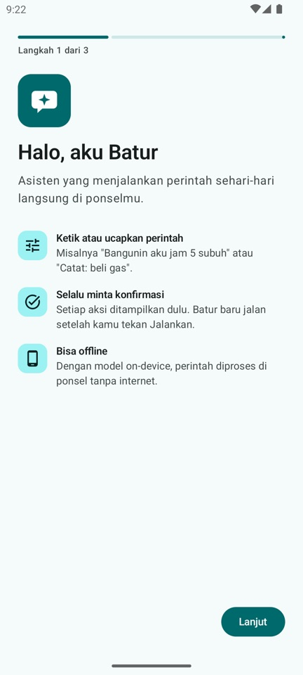
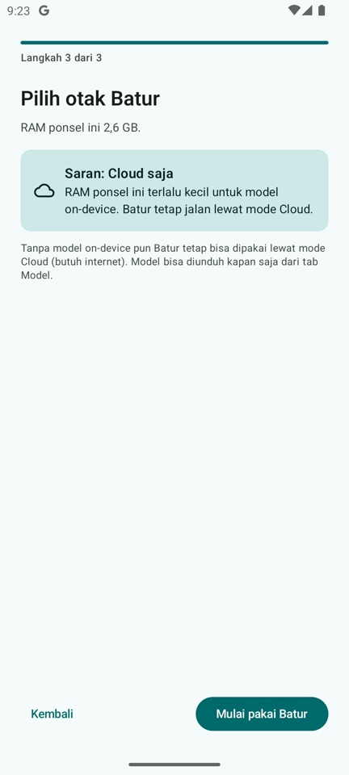
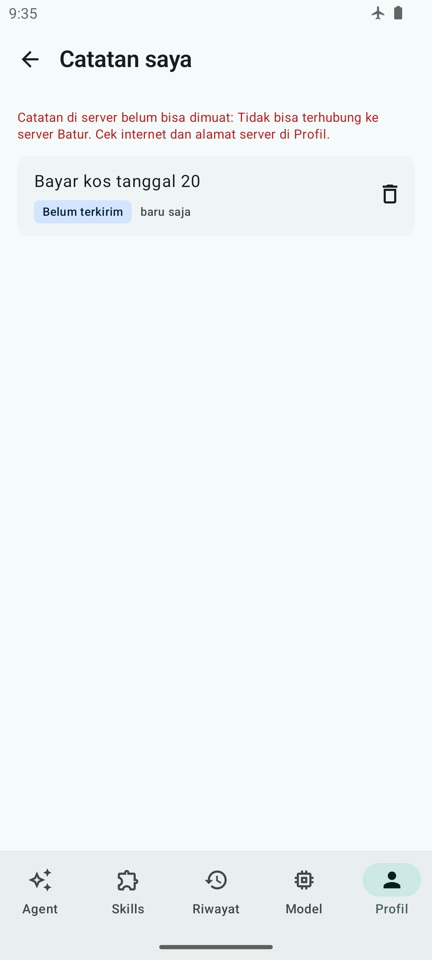
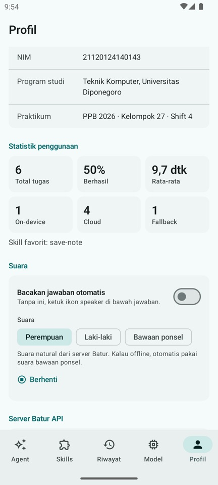
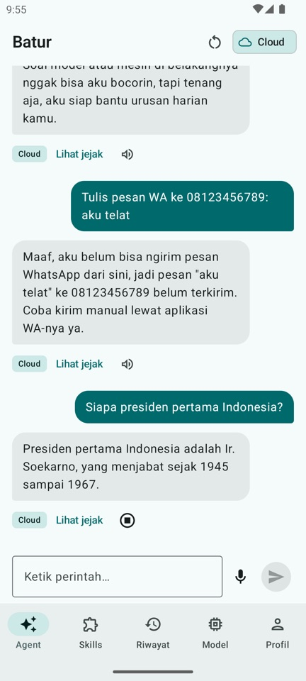
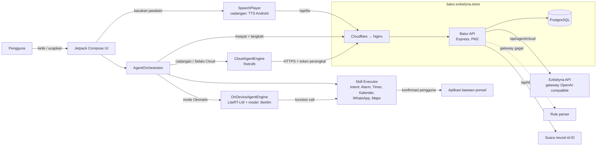

# Batur — Asisten AI On-Device untuk Eksekusi Perintah di Ponsel

Batur (bahasa Jawa: teman, pembantu) adalah aplikasi Android yang menerima perintah sehari-hari dalam bahasa Indonesia, memilih kemampuan (skill) yang cocok lewat *function calling*, meminta konfirmasi, lalu menjalankannya di ponsel, misalnya memasang alarm, membuat jadwal, atau menyiapkan pesan WhatsApp. Model AI bisa berjalan **langsung di ponsel** (LiteRT-LM) tanpa internet, dengan cadangan mode cloud lewat Batur API.

Tugas Akhir Praktikum Pemrograman Perangkat Bergerak (PPB) 2026.

| Item | Nilai |
|------|-------|
| Nama | Ahmad Putra Cahyo |
| NIM | 21120124140143 |
| Program studi | Teknik Komputer, Universitas Diponegoro |
| Praktikum | PPB 2026, Kelompok 27, Shift 4 |

**Unduh APK:** [GitHub Releases](https://github.com/cahyohackids/Batur/releases) (`Batur-v1.1.0.apk`, Android 8.0+, arm64). Langsung tersambung ke server publik `https://batur.ezkielyna.store`, tanpa perlu mengatur apa pun.

---

## Screenshot

Semua gambar diambil dari aplikasi yang benar-benar berjalan (emulator Android arm64).

| Konfirmasi aksi | Model on-device | Jawaban teks | Mode engine & antrean offline |
|:---:|:---:|:---:|:---:|
|  |  |  |  |

| Daftar skill | Detail skill | Riwayat | Jejak agent |
|:---:|:---:|:---:|:---:|
|  |  |  |  |

| Model di ponsel | Profil & statistik |
|:---:|:---:|
|  |  |

Baru di v1.1.0:

| Onboarding | Saran model sesuai RAM | Catatan (antrean offline) | Pengaturan suara | Jawaban dibacakan |
|:---:|:---:|:---:|:---:|:---:|
|  |  |  |  |  |

---

## Fitur

- **Agent** — ketik atau ucapkan perintah, Batur memilih skill, menampilkan kartu konfirmasi (Jalankan / Batal), lalu mengeksekusi lewat Intent standar Android. Pertanyaan biasa dijawab dengan teks. Perintah yang sedang diproses bisa dibatalkan, dan percakapan tetap ada setelah aplikasi ditutup.
- **Suara** — tombol mikrofon memakai pengenal suara bawaan ponsel (bahasa Indonesia, tanpa izin rekam). Jawaban Batur bisa dibacakan dengan suara natural (perempuan atau laki-laki) dari server, otomatis atau lewat ikon speaker. Kalau offline, Batur memakai suara bawaan Android.
- **6 skill**: Pasang Alarm, Jalankan Timer, Buat Jadwal (Kalender), Simpan Catatan, Draf WhatsApp, Buka Peta. Tiap skill bisa diaktifkan/nonaktifkan, khusus untuk ponsel itu saja.
- **Catatan** — halaman *Catatan saya* di Profil. Catatan yang dibuat saat offline ditandai *Belum terkirim* dan dikirim otomatis nanti.
- **Model on-device** — unduh model `.litertlm` (Qwen3 0.6B atau Gemma 4 E2B) dari halaman Model, aktifkan, dan agent berjalan tanpa internet. Aplikasi memeriksa RAM ponsel dan memberi saran model yang cocok.
- **Mode engine** — *Otomatis* (on-device dulu, naik ke cloud kalau model salah/gagal) atau *Selalu Cloud*. Mode cloud dibatasi 50 perintah per ponsel per hari.
- **Riwayat & jejak agent** — setiap perintah tersimpan beserta langkahnya: input, penalaran, pemanggilan fungsi, konfirmasi, eksekusi, respons.
- **Offline** — kalau server tidak terjangkau, riwayat dan catatan disimpan dulu di ponsel lalu dikirim otomatis saat online, tanpa dobel.
- **Onboarding dan cek update** — panduan singkat saat pertama dibuka (cek koneksi, saran model), dan banner saat ada versi APK baru.
- **Aman** — tidak memakai AccessibilityService atau izin berbahaya; setiap aksi butuh konfirmasi pengguna, dan pesan WhatsApp tetap dikirim manual oleh pengguna. Tiap ponsel punya token sendiri, jadi riwayat dan catatan tidak bisa dibaca ponsel lain.

Mode cloud ditenagai [Ezkielyna API](https://api.ezkielyna.store), gateway AI OpenAI-compatible: satu API key untuk ratusan model, bayar pakai QRIS.

---

## Arsitektur



Alur satu perintah:

1. Daftar skill aktif diambil dari `GET /api/skills/tools` (disimpan di cache untuk offline).
2. Mode *Otomatis* + model siap → model on-device memilih fungsi. Kalau keluarannya tidak valid, perintah dinaikkan ke cloud.
3. Mode cloud → `POST /api/agent/cloud` meneruskan ke gateway AI; kalau gateway tidak tersedia, server memakai rule parser.
4. Argumen dicek ulang di ponsel (misalnya durasi timer dibaca langsung dari kalimat), lalu kartu konfirmasi muncul.
5. Setelah dijalankan atau dibatalkan, tugas dan langkahnya dikirim ke `POST /api/tasks`.

| Bagian | Teknologi |
|--------|-----------|
| Android | Kotlin 2.4, Jetpack Compose (Material 3), Navigation, ViewModel + StateFlow, Retrofit + Gson, DataStore, DownloadManager, MediaPlayer + TextToSpeech |
| AI on-device | LiteRT-LM 0.19.1 (`com.google.ai.edge.litertlm`), GPU dengan cadangan CPU |
| Backend | Node.js 18+, Express 4, `pg`, `node-edge-tts` |
| Database | PostgreSQL 16 (9 tabel: `skills`, `models`, `tasks`, `task_steps`, `notes`, `devices`, `device_skill_prefs`, `agent_usage`, `tts_usage`) |
| Server | VPS Ubuntu, Nginx + Cloudflare (SSL strict, Authenticated Origin Pulls), PM2, PostgreSQL di Docker, backup harian |

---

## Struktur repo

```
Batur/
├── README.md
├── docs/screenshots/     screenshot asli dari aplikasi
├── batur-api/            backend REST API (lihat batur-api/README.md)
└── batur-android/        proyek Android Studio
```

---

## Menjalankan backend

Butuh Node.js 18+ dan PostgreSQL 16. Detail lengkap dan tabel endpoint ada di [batur-api/README.md](batur-api/README.md).

```bash
cd batur-api
cp .env.example .env      # isi DATABASE_URL; gateway AI opsional
npm install
npm run db:init           # buat tabel + data awal
npm start                 # http://localhost:3000
```

Cek: `curl http://localhost:3000/api/health`. Uji: `npm test` (rule parser, gateway, suara); dengan `TEST_DATABASE_URL` ikut menguji semua endpoint.

Tanpa isian `GATEWAY_*`, mode cloud tetap jalan memakai rule parser.

Server publik dan cara deploy ke VPS dijelaskan di [batur-api/README.md](batur-api/README.md#deploy-vps).

---

## Menjalankan aplikasi Android

**Pakai APK:** unduh dari [Releases](https://github.com/cahyohackids/Batur/releases), pasang di ponsel (izinkan instal dari sumber tidak dikenal).

**Build sendiri:** buka folder `batur-android` di Android Studio, lalu Run. Atau dari terminal:

```bash
cd batur-android
./gradlew assembleDebug   # app/build/outputs/apk/debug/app-debug.apk
```

Build release memakai `keystore.properties` (tidak ikut di repo). Tanpa file itu, `assembleRelease` tetap jalan tapi APK tidak bertanda tangan.

**Alamat server** diatur di halaman **Profil** (ada tombol *Tes koneksi*):

- APK release: `https://batur.ezkielyna.store` (bawaan). Build release hanya mau HTTPS.
- Build debug di emulator: `http://10.0.2.2:3000` (bawaan, backend di laptop).
- Build debug di HP asli: `http://<IP laptop>:3000`, dengan HP dan laptop di jaringan yang sama dan `HOST=0.0.0.0` di `.env`.

**Model on-device:** buka tab **Model**, pilih Qwen3 0.6B (343 MB, untuk RAM 4 GB) atau Gemma 4 E2B (2,6 GB, untuk RAM 6 GB+), lalu Unduh. Model pertama yang selesai diunduh langsung aktif. File model tidak disimpan di repo.

---

## Status pengujian dan batasan

Yang sudah diuji di emulator Android arm64 (RAM 2,6 GB):

- Semua 6 skill sampai aplikasi tujuan terbuka (Jam, Kalender, WhatsApp, Maps) dan catatan tersimpan di server.
- Unduh Qwen3 0.6B, pemilihan fungsi on-device, naik ke cloud saat keluaran model tidak valid.
- Mode pesawat: catatan dan riwayat masuk antrean lalu terkirim sekali saja saat online (dicek di database, tidak dobel).
- Skill yang dimatikan di satu ponsel tidak dipakai agent di ponsel itu, tapi tetap aktif di ponsel lain.
- Onboarding, halaman Catatan, mikrofon (pengenal suara Google bahasa Indonesia), banner update, tes koneksi ke server publik dari aplikasi.
- Suara: suara cloud perempuan dan laki-laki, bacakan otomatis, audio dari cache tetap bisa diputar saat offline, pilihan *Bawaan ponsel* tidak memanggil server.
- Backend: 38 uji lulus (rule parser, gateway, perapian teks suara, dan uji endpoint: token, isolasi data antar-ponsel, validasi, idempotensi, kuota). Android: 20 unit test lulus.
- Server publik: tanpa token 401, ponsel lain 404, perintah terlalu panjang 400, `/api/models` tidak memuat nama model gateway, port Node tidak terbuka ke internet.

Batasan yang perlu diketahui:

- **v1.1.0 belum diuji di HP asli** (v1.0.0 sudah terpasang dan tersambung di HP Xiaomi). Kecepatan on-device di emulator (puluhan detik sampai beberapa menit per perintah) tidak mewakili HP asli, karena emulator kekurangan RAM dan model berjalan di CPU.
- **Gemma 4 E2B belum diuji** (file 2,6 GB, butuh RAM lebih besar dari emulator). Pengujian on-device memakai Qwen3 0.6B, yang kadang salah memilih argumen; karena itu ada pengecekan ulang di ponsel dan cadangan cloud.
- APK hanya untuk arsitektur **arm64-v8a** (hampir semua HP Android modern).
- Suara cloud memakai layanan Read Aloud Microsoft Edge yang tidak resmi untuk pihak ketiga, jadi bisa berhenti sewaktu-waktu. Kalau itu terjadi, Batur otomatis memakai suara bawaan Android. Suara bawaan saat offline butuh paket suara Bahasa Indonesia yang sudah diunduh di pengaturan Text-to-speech ponsel; emulator uji tidak punya paket itu, jadi Batur menampilkan petunjuk.
- Kuota per ponsel per hari: 50 perintah mode cloud dan 200 suara baru. Mode on-device dan suara dari cache tidak dihitung.
- R8 (minify) dimatikan karena Gson dan LiteRT-LM memakai refleksi/JNI, jadi ukuran APK ±37 MB.

---

## Lisensi

Kode: MIT. File model AI tidak termasuk di repo dan mengikuti lisensi masing-masing di halaman Hugging Face-nya.
