# Batur — Asisten AI On-Device untuk Eksekusi Perintah di Ponsel

Batur (bahasa Jawa: teman, pembantu) adalah aplikasi Android yang menerima perintah sehari-hari dalam bahasa Indonesia, memilih kemampuan (skill) yang cocok lewat *function calling*, meminta konfirmasi, lalu menjalankannya di ponsel, misalnya memasang alarm, membuat jadwal, atau menyiapkan pesan WhatsApp. Model AI bisa berjalan **langsung di ponsel** (LiteRT-LM) tanpa internet, dengan cadangan mode cloud lewat Batur API.

Tugas Akhir Praktikum Pemrograman Perangkat Bergerak (PPB) 2026.

| Item | Nilai |
|------|-------|
| Nama | Ahmad Putra Cahyo |
| NIM | 21120124140143 |
| Program studi | Teknik Komputer, Universitas Diponegoro |
| Praktikum | PPB 2026, Kelompok 27, Shift 4 |

**Unduh APK:** [GitHub Releases](https://github.com/cahyohackids/Batur/releases) (`Batur-v1.0.0.apk`, Android 8.0+, arm64).

---

## Screenshot

Semua gambar diambil dari aplikasi yang benar-benar berjalan (emulator Android arm64).

| Konfirmasi aksi | Model on-device | Jawaban teks | Mode engine & antrean offline |
|:---:|:---:|:---:|:---:|
| 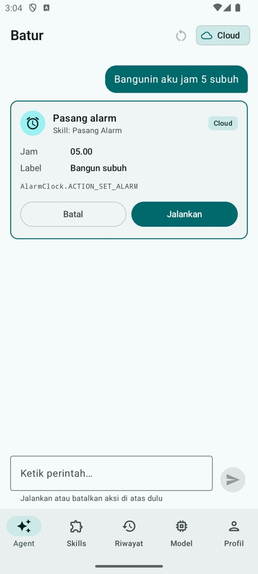 | 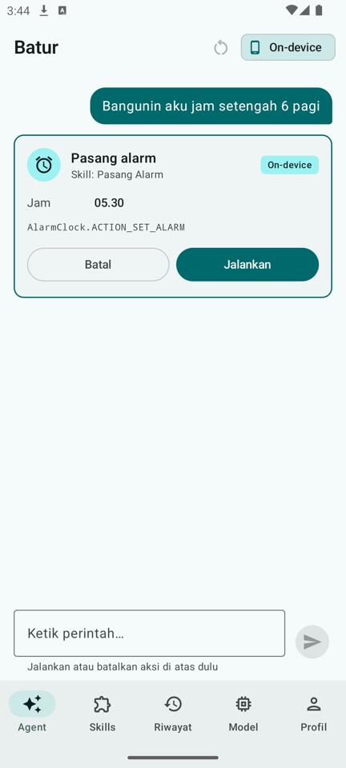 | 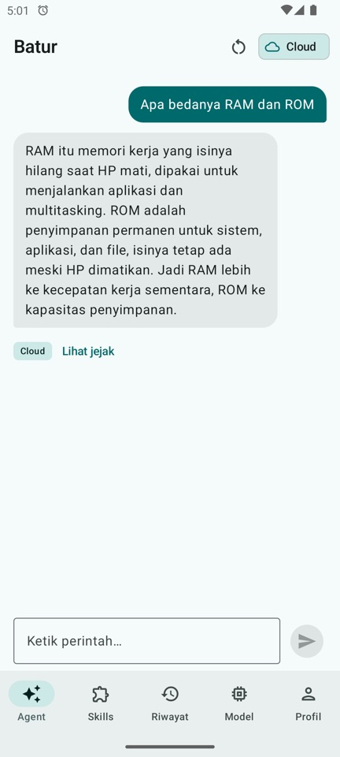 | 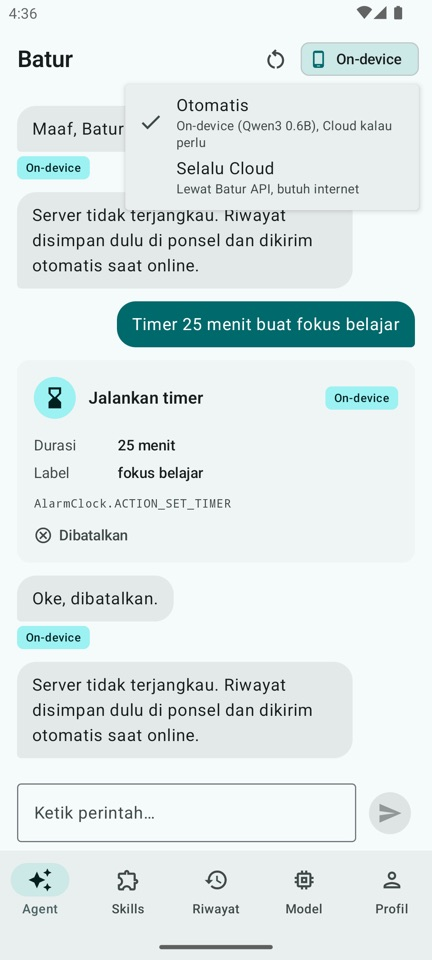 |

| Daftar skill | Detail skill | Riwayat | Jejak agent |
|:---:|:---:|:---:|:---:|
| 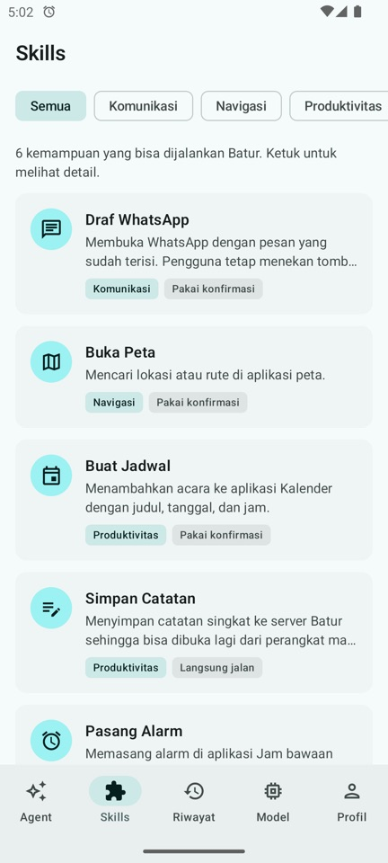 | 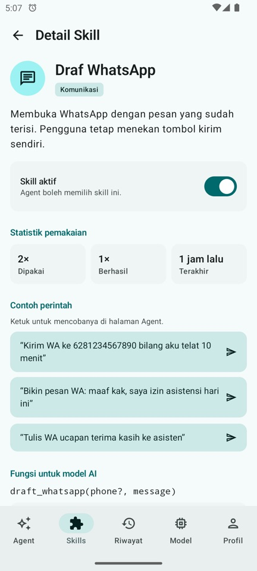 | 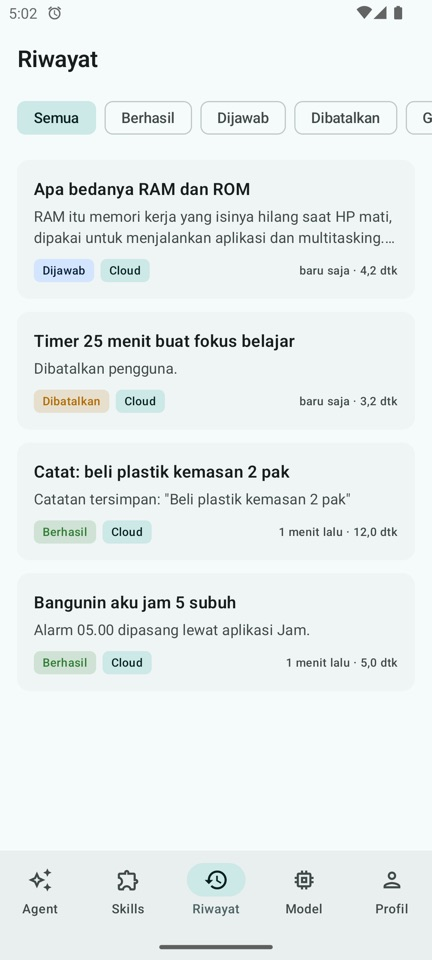 | 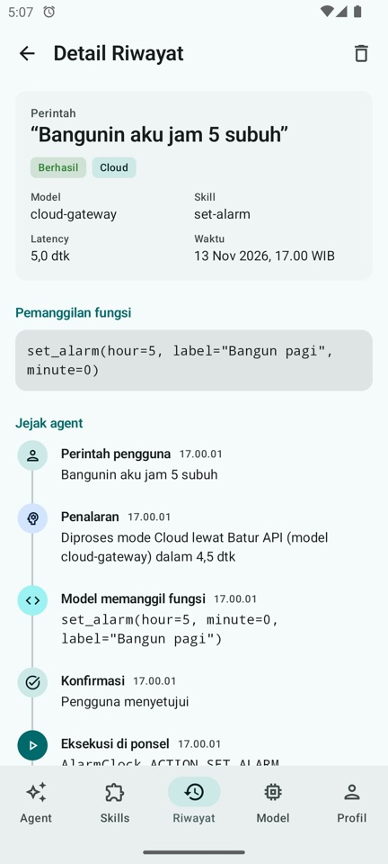 |

| Model di ponsel | Profil & statistik |
|:---:|:---:|
| 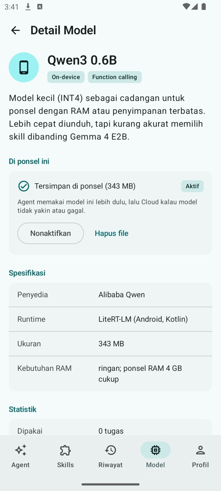 | 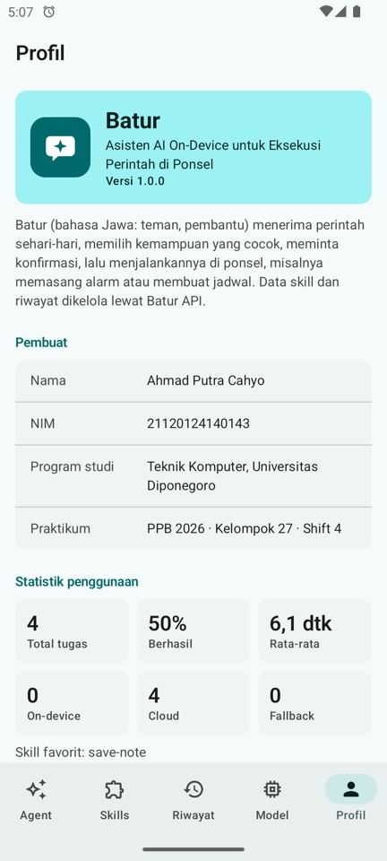 |

---

## Fitur

- **Agent** — ketik perintah, Batur memilih skill, menampilkan kartu konfirmasi (Jalankan / Batal), lalu mengeksekusi lewat Intent standar Android. Pertanyaan biasa dijawab dengan teks.
- **6 skill**: Pasang Alarm, Jalankan Timer, Buat Jadwal (Kalender), Simpan Catatan, Draf WhatsApp, Buka Peta. Tiap skill bisa diaktifkan/nonaktifkan.
- **Model on-device** — unduh model `.litertlm` (Qwen3 0.6B atau Gemma 4 E2B) dari halaman Model, aktifkan, dan agent berjalan tanpa internet.
- **Mode engine** — *Otomatis* (on-device dulu, naik ke cloud kalau model salah/gagal) atau *Selalu Cloud*.
- **Riwayat & jejak agent** — setiap perintah tersimpan beserta langkahnya: input, penalaran, pemanggilan fungsi, konfirmasi, eksekusi, respons.
- **Offline** — kalau server tidak terjangkau, riwayat disimpan dulu di ponsel dan dikirim otomatis saat online.
- **Aman** — tidak memakai AccessibilityService atau izin berbahaya; setiap aksi butuh konfirmasi pengguna, dan pesan WhatsApp tetap dikirim manual oleh pengguna.

---

## Arsitektur

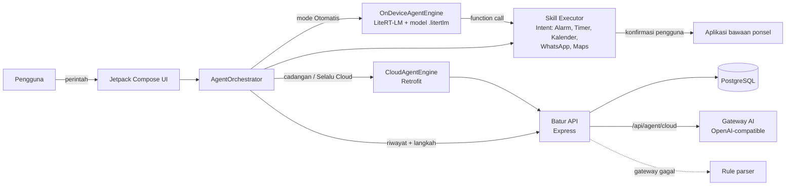

Alur satu perintah:

1. Daftar skill aktif diambil dari `GET /api/skills/tools` (disimpan di cache untuk offline).
2. Mode *Otomatis* + model siap → model on-device memilih fungsi. Kalau keluarannya tidak valid, perintah dinaikkan ke cloud.
3. Mode cloud → `POST /api/agent/cloud` meneruskan ke gateway AI; kalau gateway tidak tersedia, server memakai rule parser.
4. Argumen dicek ulang di ponsel (misalnya durasi timer dibaca langsung dari kalimat), lalu kartu konfirmasi muncul.
5. Setelah dijalankan atau dibatalkan, tugas dan langkahnya dikirim ke `POST /api/tasks`.

| Bagian | Teknologi |
|--------|-----------|
| Android | Kotlin 2.4, Jetpack Compose (Material 3), Navigation, ViewModel + StateFlow, Retrofit + Gson, DataStore, DownloadManager |
| AI on-device | LiteRT-LM 0.19.1 (`com.google.ai.edge.litertlm`), GPU dengan cadangan CPU |
| Backend | Node.js 18+, Express 4, `pg` |
| Database | PostgreSQL 16 (5 tabel: `skills`, `models`, `tasks`, `task_steps`, `notes`) |

---

## Struktur repo

```
Batur/
├── README.md
├── docs/screenshots/     screenshot asli dari aplikasi
├── batur-api/            backend REST API (lihat batur-api/README.md)
└── batur-android/        proyek Android Studio
```

---

## Menjalankan backend

Butuh Node.js 18+ dan PostgreSQL 16. Detail lengkap dan tabel endpoint ada di [batur-api/README.md](batur-api/README.md).

```bash
cd batur-api
cp .env.example .env      # isi DATABASE_URL; gateway AI opsional
npm install
npm run db:init           # buat tabel + data awal
npm start                 # http://localhost:3000
```

Cek: `curl http://localhost:3000/api/health`. Uji rule parser: `npm test`.

Tanpa isian `GATEWAY_*`, mode cloud tetap jalan memakai rule parser.

---

## Menjalankan aplikasi Android

**Pakai APK:** unduh dari [Releases](https://github.com/cahyohackids/Batur/releases), pasang di ponsel (izinkan instal dari sumber tidak dikenal).

**Build sendiri:** buka folder `batur-android` di Android Studio, lalu Run. Atau dari terminal:

```bash
cd batur-android
./gradlew assembleDebug   # app/build/outputs/apk/debug/app-debug.apk
```

Build release memakai `keystore.properties` (tidak ikut di repo). Tanpa file itu, `assembleRelease` tetap jalan tapi APK tidak bertanda tangan.

**Alamat server** diatur di halaman **Profil**:

- Emulator: `http://10.0.2.2:3000` (bawaan)
- HP asli: `http://<IP laptop>:3000`, dengan HP dan laptop di jaringan/hotspot yang sama

**Model on-device:** buka tab **Model**, pilih Qwen3 0.6B (343 MB, untuk RAM 4 GB) atau Gemma 4 E2B (2,6 GB, untuk RAM 6 GB+), lalu Unduh. Model pertama yang selesai diunduh langsung aktif. File model tidak disimpan di repo.

---

## Status pengujian dan batasan

Yang sudah diuji di emulator Android arm64 (RAM 2 GB):

- Semua 6 skill sampai aplikasi tujuan terbuka (Jam, Kalender, WhatsApp, Maps) dan catatan tersimpan di server.
- Unduh Qwen3 0.6B, pemilihan fungsi on-device, naik ke cloud saat keluaran model tidak valid.
- Mode pesawat: alarm tetap bisa dipasang on-device, riwayat masuk antrean lalu tersinkron saat online.
- APK release bertanda tangan terpasang dan berjalan normal (alarm, catatan, timer, jawaban teks, riwayat).
- Backend: 15 uji rule parser lulus.

Batasan yang perlu diketahui:

- **Belum diuji di HP asli.** Kecepatan on-device di emulator (puluhan detik sampai beberapa menit per perintah) tidak mewakili HP asli, karena emulator kekurangan RAM dan model berjalan di CPU.
- **Gemma 4 E2B belum diuji** (file 2,6 GB, butuh RAM lebih besar dari emulator). Pengujian on-device memakai Qwen3 0.6B, yang kadang salah memilih argumen; karena itu ada pengecekan ulang di ponsel dan cadangan cloud.
- APK hanya untuk arsitektur **arm64-v8a** (hampir semua HP Android modern).
- Backend berjalan di laptop, jadi riwayat dan mode cloud hanya tersedia saat HP bisa menjangkau laptop.
- R8 (minify) dimatikan karena Gson dan LiteRT-LM memakai refleksi/JNI, jadi ukuran APK ±37 MB.

---

## Lisensi

Kode: MIT. File model AI tidak termasuk di repo dan mengikuti lisensi masing-masing di halaman Hugging Face-nya.
